<p align="center">
  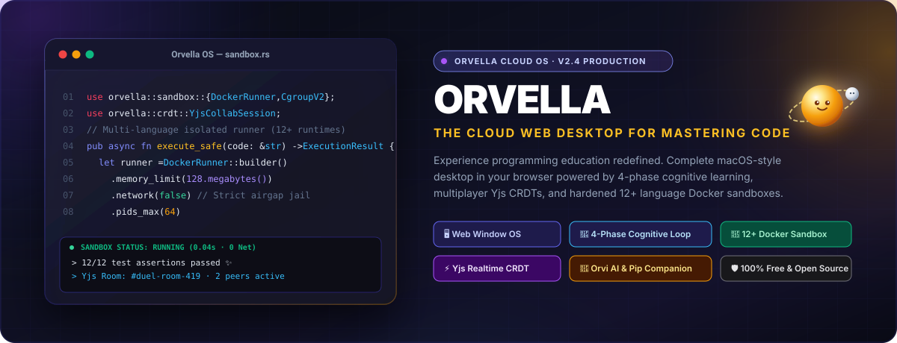
</p>

<p align="center">
  <strong>Web Desktop OS Generasi Baru untuk Menguasai Pemrograman Fullstack Secara Mendalam.</strong><br/>
  Sistem operasi cloud interaktif berbasis browser yang mengintegrasikan siklus kognitif 4 fase, sandbox multi-bahasa Docker yang aman, kolaborasi realtime Yjs, dan asisten pedagogis Orvi AI.
</p>

<p align="center">
  <a href="#-orvella-os-desktop-lingkungan-belajar-di-browser"></a>
  <a href="#-siklus-belajar-4-fase-the-4-phase-loop"></a>
  <a href="#-12-bahasa-pemrograman-terisolasi-docker"></a>
  <a href="#-kolaborasi-realtime--pembelajaran-sosial"></a>
  <a href="#-maskot-resmi-orvi--pip"></a>
  <a href="LICENSE"></a>
</p>

<p align="center">
  <a href="README.md"><b>English</b></a> · <a href="README.id.md"><b>Bahasa Indonesia</b></a> · <a href="#-panduan-instalasi--deployment"><b>Quickstart (30 Detik)</b></a> · <a href="#-akun-demo-siap-pakai"><b>Akun Demo</b></a> · <a href="#-arsitektur-sistem"><b>Arsitektur</b></a>
</p>

---

<p align="center">
  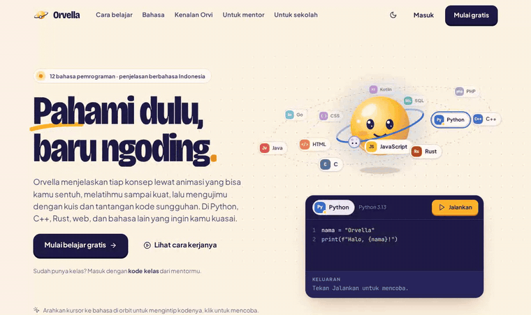
</p>

---

## 📑 Daftar Isi

- [🌟 Mengapa Orvella? Keluar dari Jebakan Tutorial Hell](#-mengapa-orvella-keluar-dari-jebakan-tutorial-hell)
- [🖥️ Orvella OS: Desktop Lingkungan Belajar di Browser](#️-orvella-os-desktop-lingkungan-belajar-di-browser)
- [🔄 Siklus Belajar 4 Fase (The 4-Phase Loop)](#-siklus-belajar-4-fase-the-4-phase-loop)
- [🌐 12+ Bahasa Pemrograman Terisolasi Docker](#-12-bahasa-pemrograman-terisolasi-docker)
- [⚡ Kolaborasi Realtime & Pembelajaran Sosial](#-kolaborasi-realtime--pembelajaran-sosial)
- [🤖 Maskot Resmi: Orvi & Pip](#-maskot-resmi-orvi--pip)
- [🏗️ Studio Materi (Curriculum Builder)](#️-studio-materi-curriculum-builder)
- [📸 Galeri Antarmuka Lengkap](#-galeri-antarmuka-lengkap)
- [⚙️ Arsitektur Sistem](#️-arsitektur-sistem)
- [🛡️ Keamanan Sandbox & Batasan Sumber Daya](#️-keamanan-sandbox--batasan-sumber-daya)
- [🚀 Panduan Instalasi & Deployment](#-panduan-instalasi--deployment)
  - [Opsi A: Docker + Cloudflare Quick Tunnel (Sangat Disarankan)](#opsi-a-docker--cloudflare-quick-tunnel-sangat-disarankan)
  - [Opsi B: Development Lokal (macOS / Linux)](#opsi-b-development-lokal-macos--linux)
  - [Opsi C: Development di Windows](#opsi-c-development-di-windows)
- [👥 Akun Demo Siap Pakai](#-akun-demo-siap-pakai)
- [🧪 Rangkaian Pengujian Otomatis](#-rangkaian-pengujian-otomatis)
- [📁 Struktur Repositori](#-struktur-repositori)
- [📄 Lisensi & Kontributor](#-lisensi--kontributor)

---

## 🌟 Mengapa Orvella? Keluar dari Jebakan Tutorial Hell

Nama **Orvella** berakar dari kata *orbit*. Dalam mekanika benda langit, sebuah satelit mengelilingi pusat gravitasi dari berbagai sudut pandang hingga lintasannya stabil dan seimbang. Kami meyakini bahwa penguasaan pemrograman membutuhkan dinamika yang sama: **mengitari konsep teknis dari setiap sudut pandang visual hingga pemahaman meresap sempurna**, sebelum melaju ke orbit materi berikutnya.

```
       [ Fase 1: PAHAMI ] ───── Model Mental Visual & Penelusuran Memori
                  │
                  ▼
       [ Fase 2: COBA ] ─────── Eksperimen Terpandu & Validasi Instan
                  │
                  ▼
       [ Fase 3: LATIH ] ────── Sandbox Docker Mandiri Tanpa Bantuan
                  │
                  ▼
       [ Fase 4: BUKTIKAN ] ─── Duel Kode 1v1 & Kuis Kelas Realtime
```

Banyak pembelajar terjebak dalam *tutorial hell* karena problem mendasar berikut:
1. **Eksekusi Gelap (Opaque)**: Pemula menyalin sintaks tanpa memahami apa yang terjadi pada pointer memori, call stack JavaScript, atau model kepemilikan (ownership) di C++/Rust.
2. **Simulator Palsu**: Banyak platform memakai regex evaluator sederhana di browser yang menolak kode siswa hanya karena beda satu spasi, alih-alih mengompilasinya secara nyata.
3. **Tab Fatigue**: Siswa kelelahan berpindah antara puluhan tab browser, terminal lokal yang rusak konfigurasinya, dan jendela editor.

**Orvella menuntaskan masalah ini.** Kami menghadirkan sistem operasi cloud lengkap di dalam browser yang menyatukan editor multi-tab, sandbox eksekusi Docker nyata tanpa akses internet, kolaborasi CRDT multi-kursor, dan tutor AI yang penuh empati.

---

## 🖥️ Orvella OS: Desktop Lingkungan Belajar di Browser

Orvella mentransformasikan tab browser menjadi workstation pengembangan modern bergaya macOS:

* **Sistem Manajemen Jendela**: Jendela dapat diseret, di-snap ke tepi layar, diminimalkan ke dock, dimaksimalkan, dan diatur z-index lapisannya.
* **Dock & Menu Bar Persisten**: Indikator status sistem, jam, telemetri jaringan, pemilih tema, dan kontrol audio player.
* **Pemutar Musik Lofi Suasana Aliran (Flow State)**: Dilengkapi generator suara ambient offline dan kurasi musik lofi agar siswa tetap fokus dalam konsentrasi tinggi.
* **Sistem Desain Dua Tema**: Tema *Obsidian Gelap* dan *Ivory Terang* dengan efek blur kaca murni modern (`backdrop-filter: blur(20px)`).
* **Keyboard-Centric**: Akses cepat Command Palette (`Cmd+K` / `Ctrl+K`), terminal gesit (`Ctrl+\``), dan panggil asisten Orvi AI (`Ctrl+J`).

---

## 🔄 Siklus Belajar 4 Fase (The 4-Phase Loop)

Setiap materi di Orvella dirancang dengan prinsip ilmu kognitif modern:

| Fase | Metodologi | Perangkat di Orvella OS | Sasaran Kognitif |
|---|---|---|---|
| **1. Pahami** | Model Mental Visual | Diagram tata letak memori, alur pointer animasi, simulasi tumpukan eksekusi | Memahami cara kerja mesin sebelum mengetik satu baris kode pun |
| **2. Coba** | Eksperimen Terpandu | Editor mikro interaktif dengan petunjuk langkah demi langkah | Bereksperimen dengan aman dan mendapat masukan semantik seketika |
| **3. Latih** | Sandbox Mandiri | Editor CodeMirror 6 multi-file, terminal eksekusi, unit test runner | Menyelesaikan tantangan teknis nyata di dalam container Docker terisolasi |
| **4. Buktikan** | Kompetisi & Sosial | Duel Kode 1v1 realtime, lobi kuis kelas langsung, lencana keahlian | Mengunci retensi memori jangka panjang lewat kolaborasi sosial |

---

## 🌐 12+ Bahasa Pemrograman Terisolasi Docker

Orvella sama sekali tidak memakai interpreter palsu. Setiap kode yang dijalankan akan memicu container eksekusi ringan yang diamankan di level kernel Linux:

```
[ Klien Web ] ──WebSocket──► [ Gateway Orvella ] ──gRPC/Docker API──► [ Penjara Container Docker ]
                                                                        ├── Jaringan: NONE (Terisolasi total)
                                                                        ├── Memori: Maksimal 128 MB
                                                                        ├── CPU: 0.5 Core (Cgroups v2)
                                                                        ├── Batas Proses: Maksimal 64 PID
                                                                        └── Sistem Berkas: Read-only + tmpfs
```

### Matriks Bahasa yang Didukung

| Bahasa | Runtime / Kompiler | Batas Memori | Batas Waktu | Profil Keamanan |
|---|---|---|---|---|
| **Python** | Python 3.12 (CPython) | 128 MB | 5 detik | Airgapped, tmpfs `/tmp` |
| **TypeScript** | Node.js 22 + `tsx` | 192 MB | 5 detik | Isolasi sistem berkas |
| **JavaScript** | Node.js 22 LTS | 128 MB | 5 detik | Profil keamanan ketat |
| **Rust** | `rustc` 1.80 + Cargo | 256 MB | 10 detik | Artefak build terisolasi |
| **C++** | `g++` 13 (C++20, `-O2`) | 128 MB | 5 detik | Ruang memori terlindungi |
| **C** | `gcc` 13 (C17, `-Wall`) | 128 MB | 5 detik | Blokir eksploitasi syscall |
| **Go** | Go 1.23 standard runner | 192 MB | 6 detik | Socket jaringan dinonaktifkan |
| **Java** | OpenJDK 21 LTS | 256 MB | 7 detik | Jejak footprint JVM minimal |
| **PHP** | PHP 8.3 CLI | 128 MB | 5 detik | Shell exec dimatikan |
| **Ruby** | Ruby 3.3 YJIT | 128 MB | 5 detik | Sandboxed stdlib |
| **Bash** | GNU Bash 5.2 | 64 MB | 4 detik | Proteksi serangan fork bomb |
| **Lua** | Lua 5.4.6 | 64 MB | 4 detik | Lingkungan jail ketat |

---

## ⚡ Kolaborasi Realtime & Pembelajaran Sosial

Orvella menerapkan lapisan kolaborasi realtime kelas enterprise bertenaga **Yjs CRDT** melalui koneksi WebSocket aman:

* **Ngoding Bareng (Live Pair Programming)**: Multi-kursor dengan nama siswa, sinkronisasi teks realtime tanpa konflik (CRDT), dan navigasi pohon berkas terpadu.
* **Duel Kode 1v1**: Sistem matchmaking otomatis yang mempertemukan dua siswa dalam tantangan algoritma. Bar progres realtime menunjukkan jumlah test case yang lolos tanpa membocorkan isi kode lawan.
* **Lobi Kuis Kelas Langsung**: Guru dapat memulai sesi kuis interaktif dengan hitung mundur otomatis, penilaian instan, dan podium pemenang langsung di layar proyektor kelas.
* **Mode Pengamat (Spectator)**: Guru dapat langsung melompat masuk ke sandbox siswa mana pun untuk memberikan bimbingan kode secara live.

---

## 🤖 Maskot Resmi: Orvi & Pip

<p align="center">
  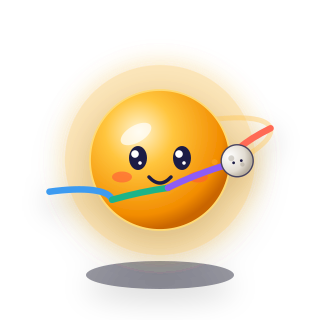
</p>

Orvella memiliki maskot orisinal yang dianimasikan secara halus dengan GSAP:

### ☀️ Orvi
Bola cahaya marigold hangat yang selalu menyapa siswa dari dock sistem. Orvi mewakili pedagogi yang berempati: tidak pernah mencela atau memarahi saat siswa salah, melainkan mengajukan pertanyaan reflektif ala Sokrates agar siswa menemukan sendiri solusinya.

### 🌕 Pip
Bulan satelit mungil yang setia mengitari cincin orbit Orvi pada kemiringan −16°. Pip bertindak sebagai tangan fisik Orvi:
* **Menunjuk (`point`)**: Pip melepaskan diri dari orbit, melesat ke baris kode yang menyebabkan galat logika, mengetuk dua kali untuk memberi petunjuk, lalu kembali ke orbitnya.
* **Membawa (`carry`)**: Mengangkut nilai variabel dan struktur data di layar selama demonstrasi visual berlangsung.

### Arsitektur AI Multi-Provider
Orvi AI dapat dikoneksikan dengan berbagai penyedia model bahasa terkemuka:
* **OpenAI** (`gpt-4o`, `o1-mini`)
* **Anthropic** (`claude-3-5-sonnet`, `claude-3-7-sonnet`)
* **Google Gemini** (`gemini-2.0-flash`, `gemini-1.5-pro`)
* **Groq** (`llama-3.3-70b-versatile` dengan latensi super kilat &lt;150ms)
* **DeepSeek** (`deepseek-coder`, `deepseek-r1`)

---

## 🏗️ Studio Materi (Curriculum Builder)

Orvella dilengkapi dengan studio pembuatan materi khusus bagi tenaga pengajar:
* **Penyusun Langkah Interaktif**: Buat modul kurikulum menggunakan markdown dengan checkpoint interaktif dan petunjuk bertahap.
* **Matriks Pengujian Otomatis**: Tetapkan test case rahasia maupun publik dengan pencocokan stdin/stdout, regex, atau skrip validator khusus.
* **Pohon Keterampilan (Skill Tree)**: Visualisasi roadmap keahlian dengan pembukaan materi prasyarat, perhitungan XP, dan sertifikat penguasaan.

---

## 📸 Galeri Antarmuka Lengkap

<div align="center">
  <table>
    <tr>
      <td width="50%">
        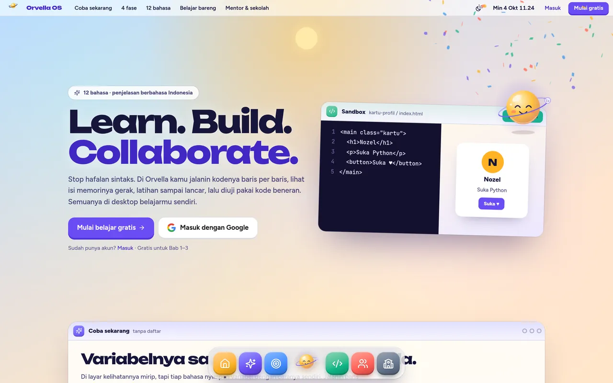
        <p align="center"><b>Halaman Utama &amp; Hero Interaktif</b></p>
      </td>
      <td width="50%">
        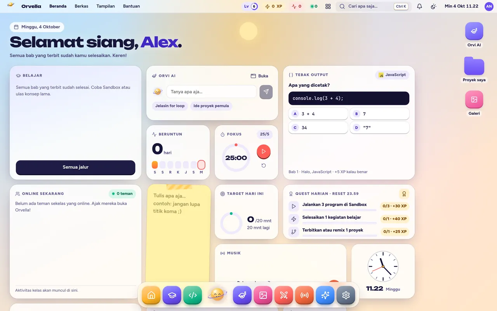
        <p align="center"><b>Orvella Desktop OS — Mode Terang (Ivory)</b></p>
      </td>
    </tr>
    <tr>
      <td width="50%">
        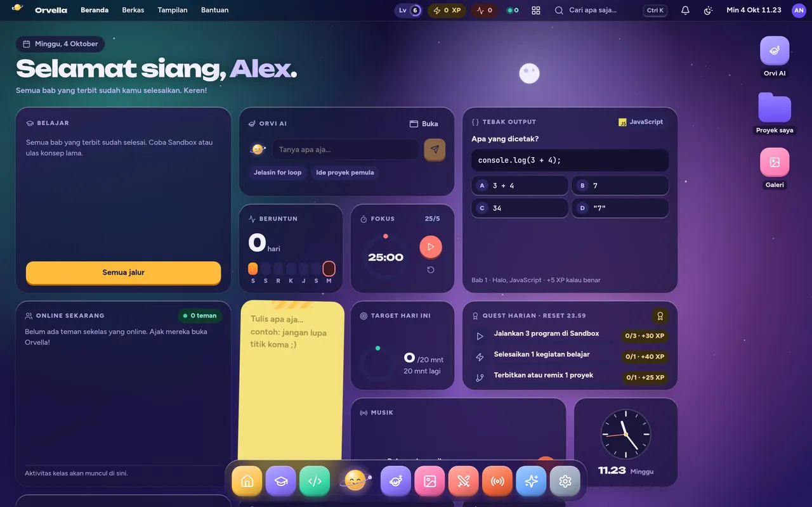
        <p align="center"><b>Orvella Desktop OS — Mode Gelap (Obsidian)</b></p>
      </td>
      <td width="50%">
        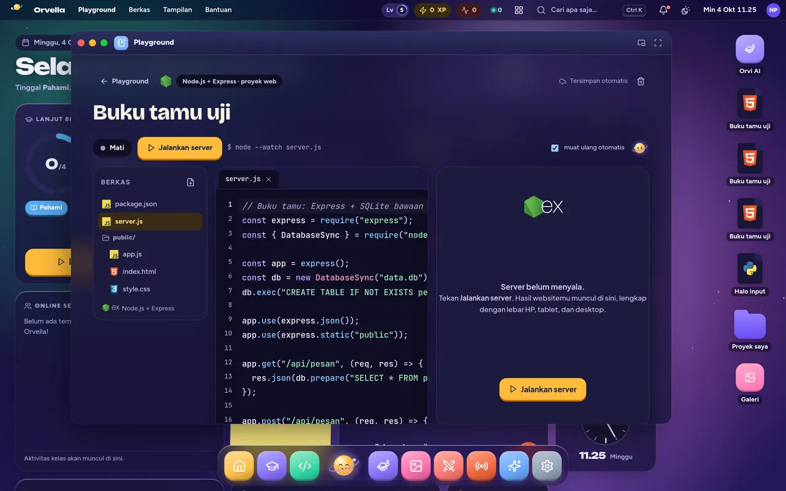
        <p align="center"><b>Sandbox Kode Multi-File dengan Runner Docker</b></p>
      </td>
    </tr>
    <tr>
      <td width="50%">
        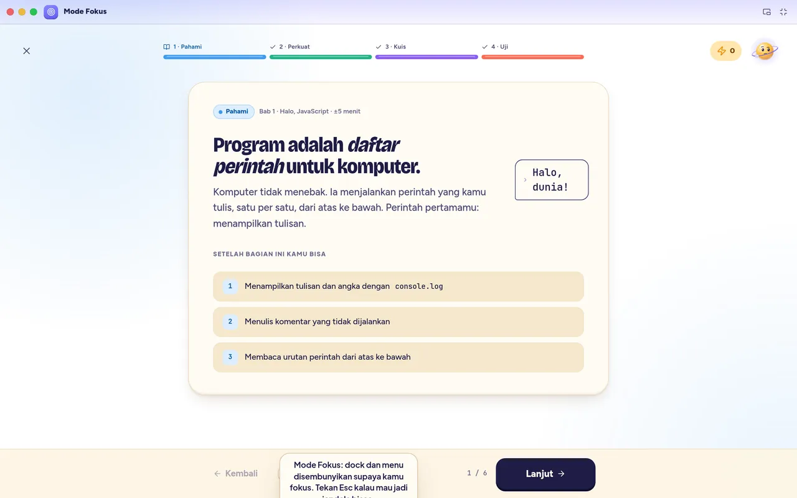
        <p align="center"><b>Fase 1: Pahami — Model Mental Visual Memori</b></p>
      </td>
      <td width="50%">
        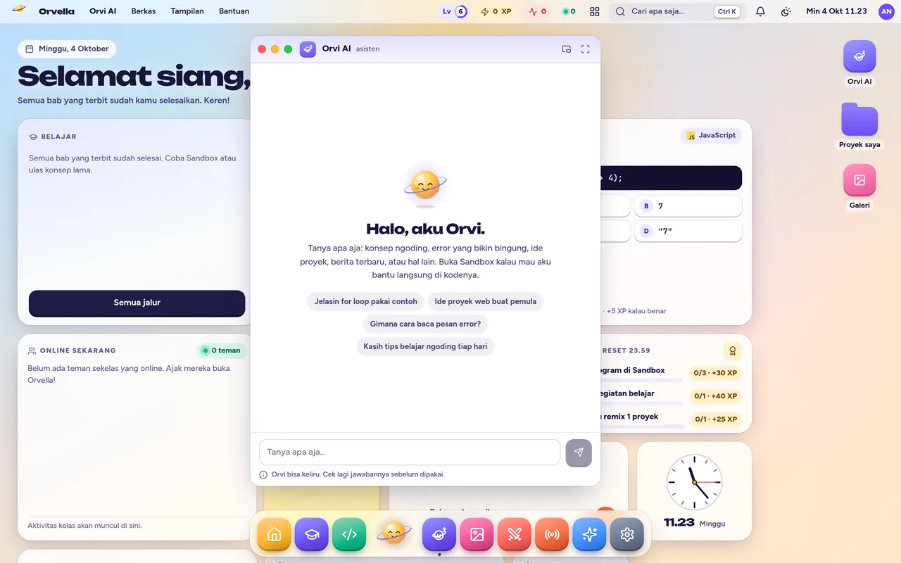
        <p align="center"><b>Asisten Orvi AI dengan Bimbingan Kontekstual</b></p>
      </td>
    </tr>
    <tr>
      <td width="50%">
        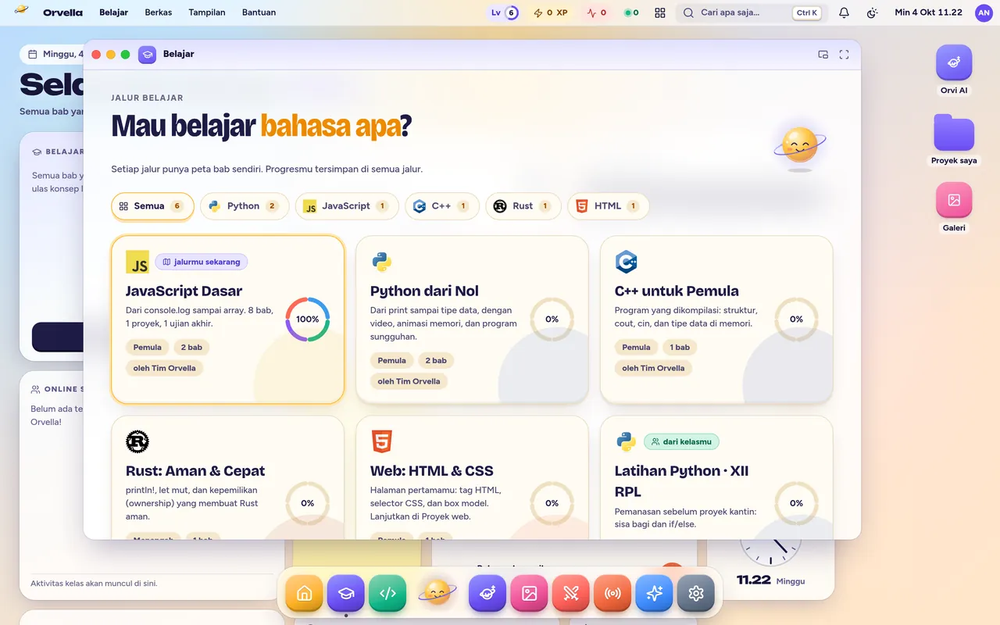
        <p align="center"><b>Pohon Keterampilan &amp; Jalur Belajar Berjenjang</b></p>
      </td>
      <td width="50%">
        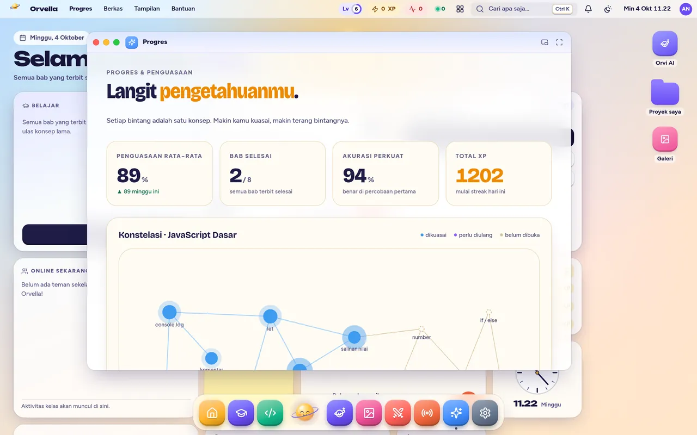
        <p align="center"><b>Analitik Belajar &amp; Laporan Penguasaan Materi</b></p>
      </td>
    </tr>
  </table>
</div>

---

## ⚙️ Arsitektur Sistem

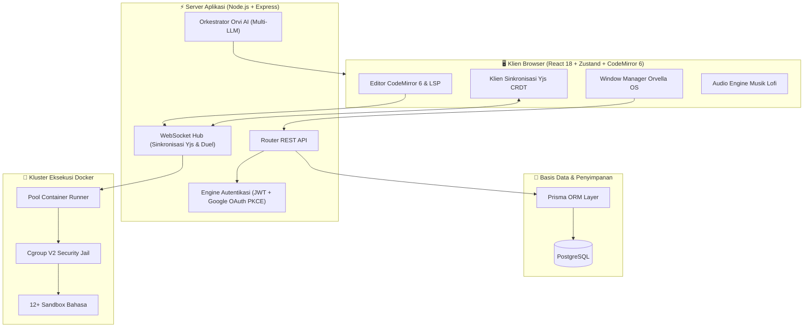

---

## 🛡️ Keamanan Sandbox & Batasan Sumber Daya

Mengingat kode yang dikirim siswa dieksekusi langsung pada server Anda, Orvella menerapkan isolasi multi-lapis yang sangat ketat:

1. **Jaringan Terputus Total**: Seluruh container runner dijalankan dengan bendera `--network none`. Tidak ada paket data masuk maupun keluar yang diizinkan.
2. **Batasan Sumber Daya**:
   - `Memori`: Maksimal 128 MB – 256 MB per container.
   - `CPU`: Dibatasi maksimal 0.5 CPU core via Linux `cgroups v2`.
   - `Batas Proses`: Maksimal 64 PID untuk mencegah serangan fork-bomb.
3. **Keamanan Sistem Berkas**: Sistem berkas root dipasang secara read-only (`ro`). Berkas sementara hanya dapat ditulis ke memori ephemeral `tmpfs` di `/tmp` (maksimal 32 MB) dan otomatis musnah saat container berhenti.
4. **Penyaringan Syscall**: Profil `seccomp` khusus menonaktifkan pelacakan kernel, raw socket, dan panggilan sistem yang berpotensi eskalasi hak akses root.

---

## 🚀 Panduan Instalasi & Deployment

### Opsi A: Docker + Cloudflare Quick Tunnel (Sangat Disarankan)

Jalankan Orvella dalam mode produksi hanya dengan satu perintah. Sudah mencakup tunnel HTTPS publik otomatis dari Cloudflare (tanpa perlu port forwarding router):

```bash
# 1. Klon repositori
git clone https://github.com/Nozella-Alexiee/orvella.git
cd orvella

# 2. Jalankan skrip bootstrap otomatis
bash deploy-quick.sh
```

Skrip ini akan menyalakan container, menjalankan migrasi basis data, mengisi materi kurikulum demo, dan menampilkan URL lokal beserta URL tunnel publik yang siap diakses dari mana saja.

### Opsi B: Development Lokal (macOS / Linux)

```bash
# 1. Pasang dependensi
npm install

# 2. Siapkan variabel lingkungan
cp .env.example .env

# 3. Jalankan migrasi basis data & isi materi demo
npx prisma migrate dev
npm run seed

# 4. Nyalakan server development lokal
npm run dev
```

Buka `http://localhost:3000` di peramban web Anda.

### Opsi C: Development di Windows

```powershell
# Di terminal PowerShell:
npm install
copy .env.example .env
npx prisma migrate dev
npm run seed
npm run dev
```

---

## 👥 Akun Demo Siap Pakai

Sistem otomatis menyediakan akun untuk setiap peran pengguna:

| Peran | Email | Kata Sandi | Hak Akses |
|---|---|---|---|
| **Siswa** | `student@orvella.dev` | `orvella123` | Akses penuh ke desktop OS, modul materi, sandbox, duel 1v1, dan kuis |
| **Guru** | `guru@orvella.dev` | `orvella123` | Studio kurikulum, host kuis langsung, buku nilai & analitik siswa |
| **Admin** | `admin@orvella.dev` | `orvella123` | Kontrol administratif penuh, manajemen pengguna, log audit sistem |

---

## 🧪 Rangkaian Pengujian Otomatis

Orvella menjamin keandalan kode melalui pengujian komprehensif:

```bash
# Jalankan unit & integration test
npm test

# Uji keamanan isolasi runner sandbox
npm run test:sandbox

# Jalankan pengujian end-to-end browser
npm run test:e2e
```

---

## 📁 Struktur Repositori

```
orvella/
├── docs/                   # Aset dokumentasi, banner, dan tangkapan layar
│   ├── assets/             # Banner SVG, maskot vektor, dan GIF hero
│   └── shots/              # Galeri antarmuka format webp resolusi tinggi
├── prisma/                 # Skema basis data Prisma & skrip migrasi
├── public/                 # Aset statis, audio lofi, dan font web
├── runner/                 # Definisi container runner Docker yang diamankan
│   └── runtimes/           # Dockerfile untuk 12+ bahasa pemrograman
├── src/
│   ├── app/                # Next.js App Router (halaman & endpoint API)
│   ├── components/         # Komponen UI React & sistem window manager
│   │   ├── desktop/        # Window manager, dock, taskbar, & pemutar audio
│   │   ├── editor/         # Editor multi-file CodeMirror 6 & klien LSP
│   │   ├── mascot/         # Pengendali animasi GSAP maskot Orvi & Pip
│   │   └── sandbox/        # Output runner realtime, visualizer jejak memori
│   ├── lib/                # Utilitas inti (sinkronisasi Yjs, auth, klien Docker)
│   └── styles/             # Token Tailwind CSS & styling efek blur kaca
├── deploy-quick.sh         # Peluncur satu-klik Docker + Cloudflare tunnel
├── docker-compose.yml      # Orkestrasi layanan multi-container
└── package.json            # Dependensi dan skrip npm
```

---

## 📄 Lisensi & Kontributor

Orvella dirilis di bawah naungan lisensi **[MIT License](LICENSE)**.

Dikembangkan dan dirawat dengan penuh dedikasi oleh **[Alex (Nozella-Alexiee)](https://github.com/Nozella-Alexiee)** &amp; para kontributor sumber terbuka.
<br/>
*Diciptakan untuk jiwa-jiwa penasaran yang ingin memahami logika pemrograman hingga ke akar-akarnya.*
