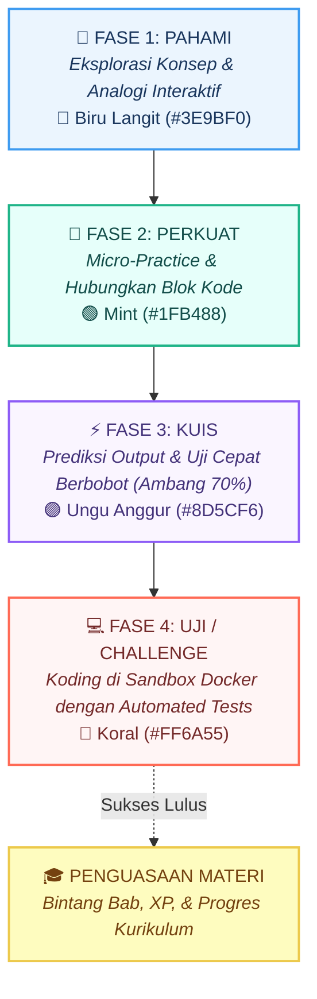
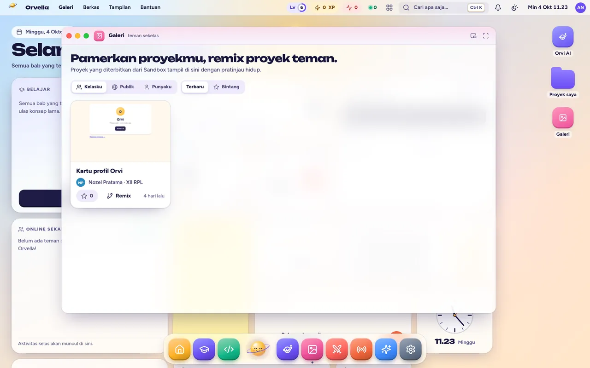
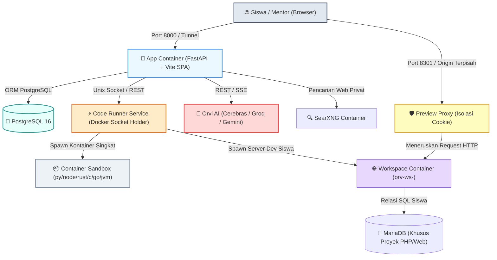

<p align="center">
  
</p>

<p align="center">
  <strong>Learn. Build. Collaborate.</strong><br/>
  Platform Belajar Pemrograman Fullstack Interaktif Berbasis Siklus 4 Fase Kognitif, Desktop OS di Browser, Multi-Container Runner Docker Aman, dan Kolaborasi Realtime.
</p>

<p align="center">
  <a href="#-orvella-os-desktop-lingkungan-belajar-di-browser"></a>
  <a href="#-siklus-belajar-4-fase-the-4-phase-loop"></a>
  <a href="#-maskot-resmi-orvi--pip"></a>
  <a href="#-12-bahasa-pemrograman-terisolasi"></a>
  <a href="#-kolaborasi-realtime--multiplayer"></a>
  <a href="#-orvi-ai-asisten-ngoding-multi-provider-ctrlj"></a>
  <a href="LICENSE"></a>
</p>

---

<p align="center">
  
</p>

---

## 📑 Daftar Isi

- [🌟 Mengenal Orvella: Belajar Ngoding dari Paham](#-mengenal-orvella-belajar-ngoding-dari-paham)
- [🪐 Maskot Resmi: Orvi & Pip](#-maskot-resmi-orvi--pip)
- [🖥️ Orvella OS: Desktop Lingkungan Belajar di Browser](#️-orvella-os-desktop-lingkungan-belajar-di-browser)
- [🤖 Orvi AI: Asisten Ngoding Multi-Provider (Ctrl+J)](#-orvi-ai-asisten-ngoding-multi-provider-ctrlj)
- [🔄 Siklus Belajar 4 Fase (The 4-Phase Loop)](#-siklus-belajar-4-fase-the-4-phase-loop)
- [🌐 12+ Bahasa Pemrograman Terisolasi](#-12-bahasa-pemrograman-terisolasi)
- [⚡ Kolaborasi Realtime & Multiplayer](#-kolaborasi-realtime--multiplayer)
- [📸 Galeri Antarmuka Lengkap](#-galeri-antarmuka-lengkap)
- [🏗️ Studio Materi (Curriculum Builder)](#️-studio-materi-curriculum-builder)
- [🎨 Desain Sistem: Susu, Nila, & Marigold](#-desain-sistem-susu-nila--marigold)
- [🛡️ Arsitektur Keamanan & Sistem Peran](#️-arsitektur-keamanan--sistem-peran)
- [⚙️ Diagram Arsitektur Sistem](#️-diagram-arsitektur-sistem)
- [🚀 Panduan Menjalankan Aplikasi](#-panduan-menjalankan-aplikasi)
  - [Opsi A: Docker + Cloudflare Quick Tunnel (Satu Perintah, Otomatis)](#opsi-a-docker--cloudflare-quick-tunnel-satu-perintah-otomatis)
  - [Opsi B: Development Lokal Linux / macOS](#opsi-b-development-lokal-linux--macos)
  - [Opsi C: Development di Windows](#opsi-c-development-di-windows)
  - [Opsi D: Manajemen Database & Cadangan](#opsi-d-manajemen-database--cadangan)
- [👥 Akun Demo Siap Pakai](#-akun-demo-siap-pakai)
- [🧪 Pengujian & Quality Assurance](#-pengujian--quality-assurance)
- [📁 Struktur Repositori](#-struktur-repositori)
- [📄 Lisensi](#-lisensi)

---

## 🌟 Mengenal Orvella: Belajar Ngoding dari Paham

Nama **Orvella** berakar dari kata *orbit*. Filosofi pembelajaran kami memandang penguasaan konsep pemrograman layaknya sebuah benda langit yang mengorbit: **dikitari dan dipelajari dari berbagai sudut pandang hingga benar-benar dipahami**, sebelum melaju ke orbit materi berikutnya.

Banyak pelajar terjebak dalam *tutorial hell* karena hanya menyalin sintaks tanpa memahami alur eksekusi memori, relasi variabel, maupun arsitektur sistem. Orvella mengatasi masalah ini secara komprehensif melalui:
1. **Model Mental Visual**: Setiap konsep (pointer C++, ownership Rust, event-loop JS, memory trace Python) disimulasikan secara visual.
2. **Eksekusi Sandbox Nyata**: Bukan simulator palsu! Kode benar-benar dikompilasi dan dieksekusi di container Docker terisolasi tanpa jaringan.
3. **Pengalaman Desktop Terpadu (Orvella OS)**: Siswa tidak membuka puluhan tab yang berantakan; mereka memiliki desktop virtual lengkap dengan editor, terminal, browser preview, pemutar musik, dan asisten AI.
4. **Pembelajaran Sosial & Kolaboratif**: Fitur *Ngoding Bareng* (Yjs CRDT), *Duel 1v1*, serta *Kuis Langsung Kelas* menghidupkan suasana kelas layaknya lingkungan kerja tim profesional.

---

## 🪐 Maskot Resmi: Orvi & Pip

<p align="center">
  
</p>

Orvella memiliki maskot orisinal yang dirancang dengan sistem animasi dinamis berbasis GSAP:

### ☀️ Orvi
Bola cahaya marigold hangat yang selalu menemani siswa di dock sistem. Orvi bersifat penasaran, jujur, dan berempati tinggi. Ia tidak pernah memarahi, mengejek, atau membuat siswa merasa kecil saat salah.

### 🌕 Pip
Bulan mungil bercahaya yang setia mengitari orbit cincin Orvi (−16°). Pip berfungsi sebagai satu-satunya "tangan" Orvi:
* **`point`**: Pip dapat melepaskan diri dari orbit, melesat ke baris kode tertentu di layar, mengetuk dua kali untuk memberi petunjuk, lalu kembali ke orbitnya.
* **`carry`**: Mengambil nilai data dari satu elemen visual dan menjatuhkannya ke kotak memori siswa.

### 🎭 Ragam Ekspresi & Mood Emosi Orvi
Orvi memiliki 7 state emosi adaptif yang bereaksi secara real-time terhadap aktivitas siswa:

| Mood | Tampilan Mata & Mulut | Perilaku Pip | Situasi Pemicu |
|---|---|---|---|
| `idle` | Mata terbuka, mengikuti posisi kursor | Mengorbit santai (5,2 detik/putaran) | Kondisi santai di desktop |
| `happy` | Mata melengkung tersenyum (`^ ^`) | Berputar cepat (3,6 detik/putaran) | Jawaban latihan benar, tantangan terpecahkan |
| `think` | Melirik ke kanan atas, alis terangkat | Mengorbit lambat (10 detik) + gelembung pikir | Sedang mengevaluasi kode, menyiapkan hint |
| `focus` | Mata menyipit fokus, alis turun | Orbit konstan stabil | Siswa sedang mengerjakan Kuis & Uji |
| `oops` | Mata membesar kaget, mulut "o" | Orbit bergoyang oleng (2,6 detik) | Output belum sesuai, terjadi kesalahan sintaks |
| `sleep` | Mata terpejam damai, balon `zZ` | Beristirahat diam di atas kepala Orvi | 30 detik tanpa aktivitas input |
| `cheer` | Mata bersinar gembira, mulut terbuka lebar | Berputar super cepat (1,1 detik) + partikel kilau | Bab tuntas, naik level, memenangkan duel |

> 🎮 **Interaksi Seru**: Kamu bisa mengklik Orvi untuk meminta tips, menahannya untuk mengelus, mencoleknya 6× hingga ia pusing berputar, atau menyeretnya langsung ke jendela kode yang sedang kamu kerjakan!

---

## 🖥️ Orvella OS: Desktop Lingkungan Belajar di Browser

Orvella menghadirkan pengalaman antarmuka bergaya sistem operasi desktop modern yang berjalan 100% di peramban web:

<p align="center">
  
  
</p>

* **Window Manager Sejati**:
  * Tombol kontrol jendela ala macOS (*traffic lights*: tutup merah, minimalkan kuning dengan animasi genie, maksimalkan hijau).
  * Snap jendela dua sisi (split screen) berbasis algoritma FLIP dan snapping magnet tepi layar.
  * **Mode Layang (Picture-in-Picture)**: Jendela kecil yang selalu menempel di sudut atas saat kamu menyimak materi sambil ngoding.
* **Mission Control (F3 / `Ctrl+↑`)**: Tampilan ikhtisar seluruh jendela yang terbuka dengan satu tombol cepat.
* **Spotlight Universal (`Ctrl+K`)**: Pencarian instan untuk melompat ke materi, membuka proyek, memanggil aplikasi dock, hingga mengaktifkan fitur rahasia (*easter eggs*).
* **Ekosistem Widget Desktop Interaktif**:
  * 🎯 **Tebak Output Harian**: Soal mikro harian berhadiah +5 XP yang divalidasi langsung oleh server.
  * 📝 **Catatan Tempel (Sticky Notes)**: Mencatat konsep penting atau catatan pribadi yang tersimpan otomatis.
  * ⏱️ **Timer Fokus Pomodoro**: Manajemen waktu belajar yang status sisa waktunya dapat dilihat oleh teman sekelas secara live.
  * 🎵 **Pemutar Musik Lo-Fi**: Musik instrumen pengiring konsentrasi belajar tanpa distraksi.
  * 🏆 **Quest & Lencana Stiker**: 8 lencana pencapaian stiker unik dengan sistem XP yang membuka wallpaper eksklusif.

---

## 🤖 Orvi AI: Asisten Ngoding Multi-Provider (`Ctrl+J`)

Di dalam dock Orvella OS terpasang asisten AI cerdas bernama **Orvi AI** yang dirancang khusus untuk pendidikan pemrograman:

<p align="center">
  
</p>

* **Integrasi Workspace Aktif**: Saat jendela Sandbox dibuka, Orvi otomatis terhubung ke proyek kode siswa:
  * Membaca struktur berkas proyek.
  * Mengusulkan perbaikan dalam bentuk **kartu diff visual** (*Terapkan*, *Tolak*, atau *Urungkan*).
  * Menjalankan proyek atas izin pengguna.
* **Multi-Provider Fallback Otomatis**:
  * Didukung oleh alur pintar: **Cerebras** (Qwen 3.8 27B, jatah hingga 216 juta token/hari) ➔ **Groq** (Llama 3.3 70B ultra-low latency) ➔ **Google Gemini** (khusus percakapan konseptual).
  * Jika salah satu provider mengalami *rate-limit*, sistem secara transparan mengalihkan permintaan ke provider cadangan tanpa memutuskan sesi belajar siswa.
* **Pencarian Web Privat (SearXNG)**: Orvi dapat menjelajahi internet untuk mencari dokumentasi terkini melalui container SearXNG internal yang aman dari pelacakan dan terlindungi dari akses IP internal.
* **Pedagogi Tanpa Bocoran**: Di dalam alur pelajaran (Pahami/Perkuat/Kuis), Orvi AI dibatasi hanya memberikan petunjuk metode (*scaffolding hint*), bukan menyalin jawaban final secara instan.
* **Kontrol Kuota Superadmin**: Batas kuota bawaan 30 pertanyaan per 5 jam per siswa (superadmin tanpa batas) untuk mencegah ketergantungan berlebihan dan pemborosan komputasi.

---

## 🔄 Siklus Belajar 4 Fase (The 4-Phase Loop)

Setiap materi di Orvella disusun dalam alur pedagogi siklus kognitif berurutan yang terbukti efektif mengunci pemahaman:



| Fase | Warna Aksen | Esensi Pembelajaran | Pengalaman Siswa |
|---|---|---|---|
| **1. Pahami** | 🔵 Biru Langit (`#3E9BF0`) | Mengubah konsep abstrak menjadi model mental nyata | Animasi alur variabel, slider parameter memori, diagram jejak alur data interaktif |
| **2. Perkuat** | 🟢 Mint (`#1FB488`) | Menghubungkan logika sebelum menulis sintaks kompleks | Menyusun potongan kode acak, menebak nilai variabel, latihan mikro tanpa beban nilai |
| **3. Kuis** | 🟣 Ungu Anggur (`#8D5CF6`) | Memvalidasi ketajaman logika berpikir | Pilihan ganda berbobot dengan skor kombo waktu; syarat lulus gerbang minimal 70% |
| **4. Uji** | 🔴 Koral (`#FF6A55`) | Implementasi kode nyata pada tantangan pemecahan masalah | Menulis kode di CodeMirror 6, menjalankannya di container Docker, lolos semua test-case |

<p align="center">
  
</p>

---

## 🌐 12+ Bahasa Pemrograman Terisolasi

Orvella bukan sekadar platform JavaScript browser. Kami mendukung **12 bahasa pemrograman dan teknologi web** dengan lingkungan kompilasi dan runtime sesungguhnya di container Docker terisolasi:

| Bahasa / Stack | Eksekusi Runtime | Fitur Visualizer Khusus | Proyek Web Fullstack |
|---|---|---|:---:|
| **Python** | CPython 3.12 | Visualisasi memori otomatis & jejak eksekusi variabel | ✅ Flask / FastAPI |
| **JavaScript / TypeScript** | Node.js 20+ VM | Analisis Call Stack, Web API, Event Loop | ✅ Express.js |
| **Rust** | Rustc / Cargo (Native) | Visualizer Borrow Checker & diagram Ownership memori | ❌ |
| **Go (Golang)** | Go Toolchain | Simulasi Goroutines & alur Channels | ❌ |
| **C / C++** | GCC / G++ (C++20) | Visualisasi Pointer, Alokasi Heap vs Stack | ❌ |
| **PHP** | PHP 8.3 CLI + FPM | Komunikasi database relasional nyata | ✅ PHP + MariaDB |
| **Java / Kotlin** | OpenJDK 21 (JVM) | Analisis Objek OOP & alokasi Garbage Collector | ❌ |
| **SQL** | PostgreSQL 16 & MariaDB | Tabel interaktif, diagram relasi skema ERD | Termasuk di proyek |
| **HTML5 & CSS3** | Browser Engine | Box Model Visualizer, Flexbox/Grid Playground | ✅ Desain Web Statis |

### 🔒 Arsitektur Sandbox Keras (Hardened Sandbox)
Setiap eksekusi kode siswa diproses melalui parameter keamanan berlapis:
* **Tanpa Jaringan**: Flag `--network none` mencegah request jahat keluar.
* **Hak Akses Rendah**: Dijalankan sebagai pengguna non-root `uid 10001` dengan seluruh kernel Linux capabilities dicabut (`--cap-drop=ALL`).
* **Sistem Berkas Read-Only**: Akar berkas container (`rootfs`) dikunci hanya-baca.
* **Pembatas Sumber Daya Ketat**: Batas memori (128 MB), batas proses PID (maksimal 32 proses untuk menangkal *fork bomb*), dan batas waktu eksekusi (5 detik).

---

## ⚡ Kolaborasi Realtime & Multiplayer

Orvella mentransformasikan pengalaman belajar ngoding dari aktivitas menyendiri menjadi pengalaman sosial kolaboratif:

<p align="center">
  
</p>

### 1. 👥 Ngoding Bareng (Yjs CRDT + pycrdt)
* Undang teman kelas langsung ke Sandbox melalui kode atau tautan unik (`/s/{kode}`).
* Kursor multiplayer dengan warna dan nama teman terlihat jelas di editor CodeMirror.
* Mode **Ikuti Teman (Follow Mode)**: Layar kamu otomatis bergeser mengikuti baris kode yang sedang diketik teman.
* Obrolan tim terintegrasi di sidebar dan terminal output bersama.
* **Keystroke Time-Travel Replay**: Merekam riwayat ketikan untuk audit siapa mengetik baris mana.

### 2. ⚔️ Duel Koding 1 Lawan 1
* Tantang teman sekelas dalam duel kuis berbatas waktu 5 menit (5 soal acak dari bank materi).
* Bilah progres lawan ditampilkan secara live di layar kamu.
* Perhitungan skor real-time di server dengan reward XP untuk pemenang dan peserta. Hasil duel disiarkan ke papan aktivitas kelas.

### 3. 📢 Kuis Langsung Kelas (Kahoot Mode)
* Mentor membuka ruang kuis langsung (`/mentor/kuis-langsung`) dan menayangkan layar proyektor beranimasi (`/kuis-langsung/{pin}/layar`).
* Siswa bergabung melalui kode PIN 6 digit dari perangkat masing-masing.
* Papan peringkat instan setelah setiap pertanyaan dan laporan komprehensif yang dapat diunduh dalam format CSV.

### 4. ✋ Angkat Tangan & Bantuan Mentor
* Siswa yang tersendat dapat menekan tombol *Angkat Tangan* di Sandbox, Perkuat, atau Uji.
* Mentor seketika menerima notifikasi prioritas tinggi di cockpit kelas dan dapat langsung membuka layar siswa untuk memberikan asistensi tanpa meninggalkan meja.

---

## 📸 Galeri Antarmuka Lengkap

### Katalog Jalur Kurikulum Terbuka
> Menampilkan jalur belajar multi-bahasa yang disusun bertahap, mulai dari pemrograman dasar hingga proyek web fullstack.

<p align="center">
  
</p>

---

### Galeri Proyek & Komunitas Siswa
> Ruang etalase karya siswa: aplikasi web yang dibuat di Sandbox dapat dipublikasikan, diuji coba, dan diunduh oleh teman sekelas.

<p align="center">
  
</p>

---

### Pelacak Kemajuan & Penguasaan Konsep (Mastery Tree)
> Statistik belajar mendalam: streak harian, cincin fase per materi, konsep yang perlu diulang, dan pohon keahlian.

<p align="center">
  
</p>

---

## 🏗️ Studio Materi (Curriculum Builder)

Orvella menyediakan ruang penyusunan materi komprehensif di `/studio` bagi guru dan mentor:

* **Blok Konten Modular**: Padukan teks Markdown, titik jeda video YouTube dengan pertanyaan interaktif otomatis, dan blok kode runnable.
* **Visualizer Simulator Memori**:
  * Generator jejak eksekusi memori Python otomatis.
  * Template pointer C++ dan diagram kepemilikan memori Rust.
  * Box model visualizer CSS interaktif.
* **Challenge & Test Suite Builder**: Buat tantangan ngoding dengan input/output test case, tes tersembunyi (*hidden tests*), dan validator solusi referensi.
* **Impor Cepat**: Dukungan penempelan soal secara instan atau impor massal melalui format CSV.

---

## 🎨 Desain Sistem: Susu, Nila, & Marigold

Sistem desain Orvella mengusung tema **Warm Editorial & Tactile Clay** yang ramah dan menenangkan:

* **Palet Warna Utama**:
  * Latar Terang ("Susu"): `#FDF4E3` (kontras lembut yang tidak menyilaukan).
  * Latar Gelap ("Malam"): `#14132C` (palet kosmik yang elegan).
  * Teks Utama ("Nila"): `#1E1C45`.
  * Aksen Pijar ("Marigold"): `#FFB224`.
  * Aksen Interaksi ("Lilac"): `#7466EC`.
* **Tipografi Orisinal**:
  * Judul & Angka: **Bricolage Grotesque** (display dinamis, ekspresif, dan modern).
  * Antarmuka & Teks Bacaan: **Plus Jakarta Sans** (karya anak bangsa Tokotype).
  * Editor Kode & Terminal: **JetBrains Mono** (dengan dukungan ligatur pemrograman).
* **Efek Tombol Taktil**: Tombol memiliki elevasi 4 px di bagian bawah yang terasa "ambles" saat ditekan.

---

## 🛡️ Arsitektur Keamanan & Sistem Peran

```
                     ┌─────────────────────────────────────────┐
                     │            KLIEN PERAMBAN WEB           │
                     └────────────────────┬────────────────────┘
                                          │
                         HTTPS / WSS (Cookie HttpOnly)
                                          ▼
┌─────────────────────────────────────────────────────────────────────────────┐
│                              FASTAPI BACKEND                                │
│                                                                             │
│  [Superadmin]          [Admin]               [Mentor]          [Learner]    │
│  • Manajemen AI        • Manajemen Siswa     • Studio Materi   • Orvella OS │
│  • Audit Log Lengkap   • Flagging Konten     • Antrean Review  • 4 Fase     │
│  • Penyetelan Role     • Katalog Kurikulum   • Kelas Live      • Sandbox    │
│                                                                             │
│  Layanan Keamanan:                                                          │
│  • Google OAuth 2.0 PKCE + JWKS Verification                                │
│  • Proteksi Brute-Force: Maks 5x salah/email, 30x/IP per 15 menit           │
│  • Audit Trail Log: Seluruh aktivitas krusial tercatat di tabel audit       │
└──────────────┬──────────────────────────┬─────────────────────────┬─────────┘
               │                          │                         │
       SQLAlchemy 2.0                  TCP IPC                    HTTP
               ▼                          ▼                         ▼
┌──────────────────────────┐   ┌────────────────────┐   ┌─────────────────────┐
│  POSTGRESQL 16 DATABASE  │   │  RUNNER SANDBOX    │   │  PREVIEW PROXY      │
│  • Skema Alembic (0010)  │   │  • Docker Engine   │   │  • Port 8301        │
│  • Sesi & Histori Yjs    │   │  • Non-root 10001  │   │  • Origin Terpisah  │
│  • Kuota AI & Akun       │   │  • No Network      │   │  • Cookie Partition │
└──────────────────────────┘   └────────────────────┘   └─────────────────────┘
```

---

## ⚙️ Diagram Arsitektur Sistem

Berikut alur lengkap bagaimana container dan microservices di dalam Orvella saling berinteraksi:



---

## 🚀 Panduan Menjalankan Aplikasi

### Opsi A: Docker + Cloudflare Quick Tunnel (Satu Perintah, Otomatis)

Solusi tercepat dan tanpa konfigurasi rumit. Sangat cocok untuk menguji coba atau membagikan URL aktif ke HP atau teman:

**Linux / macOS / WSL:**
```bash
chmod +x scripts/tunnel.sh
./scripts/tunnel.sh
```

**Windows (PowerShell):**
```powershell
powershell -ExecutionPolicy Bypass -File .\scripts\tunnel.ps1
```

Skrip ini akan otomatis:
1. Membuat berkas `.env` dengan kata sandi acak dan aman.
2. Membangun image sandbox multi-bahasa jika belum ada (`./scripts/build-sandbox.sh`).
3. Menyalakan PostgreSQL, MariaDB, aplikasi, runner, dan proxy pratinjau.
4. Menghubungkan ke Cloudflare Quick Tunnel dan mencetak **2 URL aktif**:
   * URL Aplikasi: `https://<acak>.trycloudflare.com`
   * URL Pratinjau Proyek Web: `https://<acak-preview>.trycloudflare.com` *(origin terpisah)*

*Perintah utilitas tunnel:*
```bash
./scripts/tunnel.sh url    # Tampilkan URL aktif saat ini
./scripts/tunnel.sh logs   # Lihat log seluruh container
./scripts/tunnel.sh stop   # Matikan service tanpa menghapus data
./scripts/tunnel.sh reset  # Reset total database ke data demo awal
```

---

### Opsi B: Development Lokal Linux / macOS

**Kebutuhan:** Docker Engine, Python 3.12+, Node.js 20+.

```bash
# 1. Setup awal (membuat .env, venv, install dependensi, migrasi DB)
./dev.sh --setup

# 2. Jalankan aplikasi (API + Vite otomatis reload)
./dev.sh

# 3. Kunjungi peramban:
# Aplikasi: http://localhost:5173
# Dokumentasi Swagger API: http://localhost:8000/docs
```

---

### Opsi C: Development di Windows

**Kebutuhan:** Python 3.12+, Node.js 20+, PostgreSQL 15+.

```powershell
# 1. Salin konfigurasi backend
copy backend\.env.example backend\.env

# 2. Setup dan jalankan
powershell -ExecutionPolicy Bypass -File .\dev.ps1 -Setup
powershell -ExecutionPolicy Bypass -File .\dev.ps1
```

---

### Opsi D: Manajemen Database & Cadangan

Orvella menyertakan utilitas pencadangan database mandiri:

```bash
# Buat snapshot cadangan (PostgreSQL + dump MariaDB)
./scripts/db.sh backup

# Lihat daftar file cadangan
./scripts/db.sh list

# Pulihkan database dari file cadangan
./scripts/db.sh restore backups/orvella-20261015-1200.dump
```

---

## 👥 Akun Demo Siap Pakai

Semua akun demo di lingkungan lokal menggunakan kata sandi: `orvella123` *(pada Docker tunnel publik, kata sandi acak dicetak di terminal)*.

| Peran | Akun Email | Kemampuan & Data Siswa |
|---|---|---|
| **Siswa (Juara)** | `nadia@smksig.sch.id` | Bab 1 selesai, Bab 2 di Perkuat 3/8, streak 12 hari, 3 konsep perlu diulang |
| **Siswa (Proyek)** | `salsa@smksig.sch.id` | Bab 2 selesai, proyek Kalkulator Uang Saku menunggu review mentor |
| **Siswa (Macet)** | `alex@smksig.sch.id` | Memicu sinyal bimbingan mentor: salah 4× berturut-turut pada gerbang logika |
| **Siswa (Lainnya)** | `rizky@` · `maya@` · `bayu@smksig.sch.id` | Simulasi ragam sinyal belajar (hint rush, stuck di kuis) |
| **Mentor / Guru** | `dimas@smksig.sch.id` | Mengampu kelas XII RPL (32 siswa), antrean review kode, akses **Studio Materi** |
| **Admin** | `sekar@smksig.sch.id` | Ringkasan kurikulum, flag konten, Studio builder, manajemen pengguna |
| **Superadmin** | Diberikan via server | Akses **Log Aktivitas Keamanan**, manajemen kuota AI, pengangkatan admin |

> Ingin mencoba alur pendaftaran siswa baru dari awal? Kunjungi halaman `/daftar`.

---

## 🧪 Pengujian & Quality Assurance

Orvella dilengkapi cakupan uji otomatis yang ketat:

```bash
# 1. Uji Backend API (Pytest)
cd backend && .venv/bin/python -m pytest -q

# 2. Validasi Tipe Frontend & Build
cd frontend && npm run typecheck && npm run build

# 3. Uji Keamanan Sandbox & Isolasi Docker
docker compose exec runner python -m pytest -q tests
```

---

## 📁 Struktur Repositori

```
orvella/
├── backend/                  # Server Web FastAPI & Layanan Bisnis
│   ├── app/routers/          # Endpoints: auth, desk, duel, livequiz, orvi, sandbox, studio
│   ├── app/services/         # Layanan AI, kompilator kode, sinyal kesulitan, badges, presence
│   ├── app/seed/             # Data awal kurikulum & akun demo
│   └── migrations/           # Riwayat migrasi skema database Alembic (0001 - 0010)
├── frontend/                 # Aplikasi Web SPA (React 19 + TypeScript)
│   ├── src/os/               # Window manager, dock, menubar, desktop, widgets
│   ├── src/orvi/             # Antarmuka chat Orvi AI, streaming SSE, tool execution
│   ├── src/sandbox/          # Cloud IDE, CodeMirror 6, Yjs realtime, terminal
│   ├── src/duel/             # Antarmuka duel koding 1 lawan 1
│   ├── src/live/             # Kuis interaktif kelas mode proyektor
│   └── src/design/           # Komponen UI, animasi GSAP, ikon, dan Orvi SVG
├── runner/                   # Microservice Docker Runner (Pemegang Docker Socket)
│   └── orv_runner/           # Manajemen isolasi kontainer, compiler, dan evaluasi hasil
├── preview/                  # Reverse Proxy Pratinjau Proyek Web (Origin Terpisah)
├── sandbox/                  # Dockerfile runtime bahasa (py, node, php, c, rust, go, jvm)
├── design/                   # Aset desain, mockup HTML, spesifikasi brand & motion
├── docs/                     # Dokumentasi visual, banner SVG, & tangkapan layar
│   ├── assets/               # orvella-banner.svg, orvi-mascot.svg, orvella-hero.gif
│   └── shots/                # Tangkapan layar resolusi tinggi seluruh antarmuka
├── scripts/                  # Skrip otomatisasi database, sandbox builder, & tunnel
├── docker-compose.yml        # Konfigurasi containerization multi-service
├── dev.sh                    # Runner praktis satu perintah dev (Linux / macOS)
├── dev.ps1                   # Runner praktis satu perintah dev (Windows)
├── LICENSE                   # Lisensi MIT
└── README.md                 # Dokumentasi utama proyek
```

---

## 📄 Lisensi

Proyek ini didistribusikan di bawah lisensi resmi **MIT License**. Terbuka untuk digunakan, dimodifikasi, dan dikembangkan bagi kemajuan teknologi pendidikan di Indonesia dan dunia.

<p align="center">
  Dibuat dengan segenap 🧡 oleh <strong>Alex (Nozella-Alexiee)</strong><br/>
  <em>Learn. Build. Collaborate · Orvella</em>
</p>
