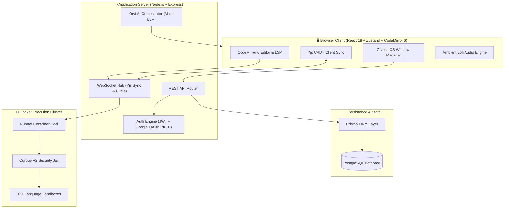

<p align="center">
  
</p>

<p align="center">
  <strong>The Next-Generation Web Desktop OS for Mastering Fullstack Programming.</strong><br/>
  An interactive, browser-based cloud operating system featuring a 4-phase cognitive learning loop, hardened multi-language Docker sandboxes, realtime Yjs multiplayer, and the Orvi AI companion.
</p>

<p align="center">
  <a href="#-orvella-os-the-browser-desktop-experience"></a>
  <a href="#-the-4-phase-cognitive-loop"></a>
  <a href="#-12-hardened-docker-language-sandboxes"></a>
  <a href="#-realtime-multiplayer--social-learning"></a>
  <a href="#-orvi-ai--pip-companion"></a>
  <a href="LICENSE"></a>
</p>

<p align="center">
  <a href="README.md"><b>English</b></a> · <a href="README.id.md"><b>Bahasa Indonesia</b></a> · <a href="#-quickstart--deployment"><b>Quickstart (30s)</b></a> · <a href="#-demo-credentials"><b>Demo Accounts</b></a> · <a href="#-system-architecture"><b>Architecture</b></a>
</p>

---

<p align="center">
  
</p>

---

## 📑 Table of Contents

- [🌟 Why Orvella? Beyond Tutorial Hell](#-why-orvella-beyond-tutorial-hell)
- [🖥️ Orvella OS: The Browser Desktop Experience](#️-orvella-os-the-browser-desktop-experience)
- [🔄 The 4-Phase Cognitive Loop](#-the-4-phase-cognitive-loop)
- [🌐 12+ Hardened Docker Language Sandboxes](#-12-hardened-docker-language-sandboxes)
- [⚡ Realtime Multiplayer & Social Learning](#-realtime-multiplayer--social-learning)
- [🤖 Orvi AI & Pip Companion](#-orvi-ai--pip-companion)
- [🏗️ Curriculum Studio (Course Builder)](#️-curriculum-studio-course-builder)
- [📸 Full Interface Gallery](#-full-interface-gallery)
- [⚙️ System Architecture](#️-system-architecture)
- [🛡️ Security Jail & Resource Limits](#️-security-jail--resource-limits)
- [🚀 Quickstart & Deployment](#-quickstart--deployment)
  - [Option A: Docker + Cloudflare Quick Tunnel (Recommended)](#option-a-docker--cloudflare-quick-tunnel-recommended)
  - [Option B: Bare-Metal Development (macOS / Linux)](#option-b-bare-metal-development-macos--linux)
  - [Option C: Bare-Metal Development (Windows)](#option-c-bare-metal-development-windows)
- [👥 Demo Credentials](#-demo-credentials)
- [🧪 Automated Testing Suite](#-automated-testing-suite)
- [📁 Repository Structure](#-repository-structure)
- [📄 License & Credits](#-license--credits)

---

## 🌟 Why Orvella? Beyond Tutorial Hell

The name **Orvella** originates from *orbit*. In planetary mechanics, a celestial body circles a gravitational center from multiple vantage points until its trajectory stabilizes. We believe mastering programming demands the same dynamic: **circling a mental model from every dimension until understanding becomes second nature**, before accelerating to the next orbit.

```
       [ Phase 1: UNDERSTAND ] ── Visual Mental Models & Memory Traces
                  │
                  ▼
       [ Phase 2: TRY ] ──────── Interactive Guided Micro-Validation
                  │
                  ▼
       [ Phase 3: TRAIN ] ────── Unassisted Multi-File Real Docker Sandbox
                  │
                  ▼
       [ Phase 4: PROVE ] ────── 1v1 Peer Duels & Live Classroom Quizzes
```

Traditional platforms suffer from critical pedagogical traps:
1. **Opaque Execution**: Learners copy syntax without grasping memory pointers, the JavaScript call stack, or C++ ownership models.
2. **Artificial "Faux" Simulators**: In-browser regex checkers that fail when code deviates by a single space, rather than running actual compilers.
3. **Tab Fatigue**: Students juggle terminal windows, documentation tabs, and editors, losing cognitive momentum.

**Orvella solves this entirely.** It delivers a full-fledged cloud OS right in the web browser, uniting a multi-tab code editor, a zero-network Docker execution jail, realtime collaborative CRDTs, and an empathy-driven AI tutor.

---

## 🖥️ Orvella OS: The Browser Desktop Experience

Orvella transforms the browser into an integrated development workstation inspired by macOS:

* **Window Management System**: Smooth window drag, edge snapping, minimize to dock, full-screen expansion, and z-index layering.
* **Persistent Dock & Menu Bar**: Global system status, clock, network telemetry, theme switcher, and audio player controls.
* **Ambient Lofi Audio Suite**: Embedded, offline-capable sound generator and curated lofi tracks to keep learners in deep flow.
* **System Themes**: Ultra-tuned Dark Obsidian and Light Ivory palettes with fluid CSS variable glassmorphic blurs (`backdrop-filter: blur(20px)`).
* **Keyboard First**: Global palette (`Cmd+K` / `Ctrl+K`), quick terminal toggle (`Ctrl+\``), and AI assistant invoke (`Ctrl+J`).

---

## 🔄 The 4-Phase Cognitive Loop

Every lesson in Orvella is architected around cognitive science principles:

| Phase | Methodology | Tools in Orvella OS | Cognitive Objective |
|---|---|---|---|
| **1. Understand** | Visual Mental Model | Animated memory layouts, pointer diagrams, call-stack visualizers | Grasp the underlying machinery before typing a single character |
| **2. Try** | Guided Interaction | Inline micro-editor with instant semantic linting & step hints | Low-stakes experimental tinkering with immediate feedback |
| **3. Train** | Unassisted Sandbox | Multi-file CodeMirror 6 editor, terminal output, unit test runner | Real-world problem solving inside an isolated Docker container |
| **4. Prove** | Competitive & Social | Realtime 1v1 Code Duels, live classroom quiz lobbies, public badges | Reinforce retention under time constraints and social collaboration |

---

## 🌐 12+ Hardened Docker Language Sandboxes

Orvella does not use mock interpreters. Every execution spawns a lightweight, disposable execution container with strict kernel-level sandboxing:

```
[ Web Client ] ──WebSocket──► [ Orvella Gateway ] ──gRPC/Docker API──► [ Hardened Jail Container ]
                                                                        ├── Network: NONE (Air-gapped)
                                                                        ├── Memory: 128MB max
                                                                        ├── CPU: 0.5 Cores (Cgroups v2)
                                                                        ├── PIDs: 64 processes max
                                                                        └── FS: Read-only root + tmpfs
```

### Supported Language Engines

| Language | Runtime / Compiler | Memory Cap | Wall-Clock Timeout | Security Isolation |
|---|---|---|---|---|
| **Python** | Python 3.12 (CPython) | 128 MB | 5 seconds | Airgapped, tmpfs `/tmp` |
| **TypeScript** | Node.js 22 + `tsx` | 192 MB | 5 seconds | No filesystem leak |
| **JavaScript** | Node.js 22 LTS | 128 MB | 5 seconds | Strict security profile |
| **Rust** | `rustc` 1.80 + Cargo | 256 MB | 10 seconds | Sandboxed build artifacts |
| **C++** | `g++` 13 (C++20, `-O2`) | 128 MB | 5 seconds | Protected memory space |
| **C** | `gcc` 13 (C17, `-Wall`) | 128 MB | 5 seconds | Zero syscall exploitation |
| **Go** | Go 1.23 standard runner | 192 MB | 6 seconds | Disabled network sockets |
| **Java** | OpenJDK 21 LTS | 256 MB | 7 seconds | Minimal JVM footprint |
| **PHP** | PHP 8.3 CLI | 128 MB | 5 seconds | Shell execs disabled |
| **Ruby** | Ruby 3.3 YJIT | 128 MB | 5 seconds | Sandboxed stdlib |
| **Bash** | GNU Bash 5.2 | 64 MB | 4 seconds | Fork bomb protection |
| **Lua** | Lua 5.4.6 | 64 MB | 4 seconds | Jailed environment |

---

## ⚡ Realtime Multiplayer & Social Learning

Orvella implements an enterprise-grade realtime collaboration layer powered by **Yjs CRDTs** over secure WebSockets:

* **Live Pair Programming (Ngoding Bareng)**: Multi-cursor presence, realtime character diffs, and synced file tree navigation. Multiple students can code inside the exact same sandbox concurrently without conflicts.
* **1v1 Code Duels**: Ranked matchmaking system pairing students on algorithmic challenges. Realtime progress bars show test cases solved without leaking code.
* **Live Classroom Quiz Lobby**: Teachers launch interactive quiz sessions with countdown timers, auto-scored submissions, and live podiums.
* **Observer Mode & Classroom Spectator**: Teachers can seamlessly drop into any student's active sandbox to offer live inline commentary.

---

## 🤖 Orvi AI & Pip Companion

<p align="center">
  
</p>

Orvella features an original animated mascot system engineered with GSAP:

### ☀️ Orvi
The golden orb of curiosity who lives in the desktop dock. Orvi embodies empathetic pedagogy: it never scolds, never shames mistakes, and guides students toward answers through Socratic questions rather than dumping raw solutions.

### 🌕 Pip
The luminous satellite moon orbiting Orvi at a calibrated −16° inclination. Pip serves as Orvi's physical pointer:
* **Point (`point`)**: Detaches from orbit, zooms to the exact line of code causing an error, taps twice to highlight the logic flaw, and returns to orbit.
* **Carry (`carry`)**: Transports memory variable states across the screen during interactive visual explanation steps.

### Multi-Provider AI Architecture
Orvi AI connects seamlessly to your choice of language model backend:
* **OpenAI** (`gpt-4o`, `o1-mini`)
* **Anthropic** (`claude-3-5-sonnet`, `claude-3-7-sonnet`)
* **Google Gemini** (`gemini-2.0-flash`, `gemini-1.5-pro`)
* **Groq** (`llama-3.3-70b-versatile` for ultra-low latency &lt;150ms)
* **DeepSeek** (`deepseek-coder`, `deepseek-r1`)

---

## 🏗️ Curriculum Studio (Course Builder)

Orvella includes a native authoring studio for educators:
* **Interactive Step Builder**: Create custom lessons with markdown, interactive checkpoints, and visual hints.
* **Automated Test Matrix**: Define hidden and public test cases with stdin/stdout assertions, regex matching, or custom validator scripts.
* **Gamified Skill Tree**: Visual progression nodes with prerequisite unlocking, XP calculation, and mastery certifications.

---

## 📸 Full Interface Gallery

<div align="center">
  <table>
    <tr>
      <td width="50%">
        
        <p align="center"><b>Modern Landing Page &amp; Interactive Hero</b></p>
      </td>
      <td width="50%">
        
        <p align="center"><b>Orvella Desktop OS — Ivory Light Mode</b></p>
      </td>
    </tr>
    <tr>
      <td width="50%">
        
        <p align="center"><b>Orvella Desktop OS — Obsidian Dark Mode</b></p>
      </td>
      <td width="50%">
        
        <p align="center"><b>Multi-File Code Sandbox with Live Runner</b></p>
      </td>
    </tr>
    <tr>
      <td width="50%">
        
        <p align="center"><b>Phase 1: Understand — Visual Mental Model</b></p>
      </td>
      <td width="50%">
        
        <p align="center"><b>Orvi AI Assistant with Contextual Guidance</b></p>
      </td>
    </tr>
    <tr>
      <td width="50%">
        
        <p align="center"><b>Gamified Skill Tree &amp; Progression Roadmap</b></p>
      </td>
      <td width="50%">
        
        <p align="center"><b>Deep Analytics &amp; Mastery Reports</b></p>
      </td>
    </tr>
  </table>
</div>

---

## ⚙️ System Architecture



---

## 🛡️ Security Jail & Resource Limits

Because code submitted by students executes on your server infrastructure, Orvella enforces uncompromising multi-tier isolation:

1. **Network Jail**: All execution containers operate with `--network none`. No outbound or inbound network packets are permitted.
2. **Resource Boundaries**:
   - `Memory`: 128 MB – 256 MB maximum per container.
   - `CPU`: Capped at 0.5 CPU shares via Linux `cgroups v2`.
   - `PIDs Max`: Strict limit of 64 processes to prevent fork-bomb attacks.
3. **Storage Security**: Root filesystem is mounted read-only (`ro`). Temporary writes are confined to an ephemeral memory `tmpfs` mounted at `/tmp` (32 MB max) and destroyed upon execution exit.
4. **Syscall Whitelisting**: Restricted `seccomp` profile disables kernel tracing, raw sockets, and privilege escalation syscalls.

---

## 🚀 Quickstart & Deployment

### Option A: Docker + Cloudflare Quick Tunnel (Recommended)

Run Orvella in production mode with a single command. Includes an automatic public HTTPS tunnel via Cloudflare (zero port forwarding required):

```bash
# 1. Clone the repository
git clone https://github.com/Nozella-Alexiee/orvella.git
cd orvella

# 2. Run the turnkey bootstrap script
bash deploy-quick.sh
```

The script will launch all containers, run database migrations, seed demo curricula, and print your private local and public tunnel URLs.

### Option B: Bare-Metal Development (macOS / Linux)

```bash
# 1. Install dependencies
npm install

# 2. Configure environment variables
cp .env.example .env

# 3. Setup database migrations & seed demo content
npx prisma migrate dev
npm run seed

# 4. Start local development server
npm run dev
```

Visit `http://localhost:3000` in your browser.

### Option C: Bare-Metal Development (Windows)

```powershell
# In PowerShell:
npm install
copy .env.example .env
npx prisma migrate dev
npm run seed
npm run dev
```

---

## 👥 Demo Credentials

The database seed provides instant accounts across all system roles:

| Role | Email | Password | Permissions |
|---|---|---|---|
| **Student** | `student@orvella.dev` | `orvella123` | Full access to desktop OS, courses, sandbox, duels, and quizzes |
| **Teacher** | `guru@orvella.dev` | `orvella123` | Curriculum builder, live quiz host, student gradebook & analytics |
| **Admin** | `admin@orvella.dev` | `orvella123` | Full administrative control, user management, audit logs |

---

## 🧪 Automated Testing Suite

Orvella maintains high quality through an extensive test suite:

```bash
# Run unit & integration tests
npm test

# Run sandbox execution safety verification
npm run test:sandbox

# Run end-to-end browser tests
npm run test:e2e
```

---

## 📁 Repository Structure

```
orvella/
├── docs/                   # Documentation assets, banners, and screenshots
│   ├── assets/             # SVG banners, vector mascots, and hero GIFs
│   └── shots/              # High-resolution webp interface gallery
├── prisma/                 # Prisma database schema and migration scripts
├── public/                 # Static assets, lofi audio files, and web fonts
├── runner/                 # Hardened Docker runner container definitions
│   └── runtimes/           # Dockerfiles for 12+ isolated programming languages
├── src/
│   ├── app/                # Next.js App Router (pages and API endpoints)
│   ├── components/         # React UI library & window management system
│   │   ├── desktop/        # Window manager, dock, taskbar, and audio player
│   │   ├── editor/         # CodeMirror 6 multi-file editor & LSP client
│   │   ├── mascot/         # GSAP animated Orvi & Pip mascot controller
│   │   └── sandbox/        # Realtime runner output, memory trace visualizer
│   ├── lib/                # Core utilities (Yjs sync, auth, Docker client)
│   └── styles/             # Tailwind CSS tokens and glassmorphism styling
├── deploy-quick.sh         # One-click Docker + Cloudflare tunnel launcher
├── docker-compose.yml      # Multi-service container orchestration
└── package.json            # Dependencies and npm scripts
```

---

## 📄 License & Credits

Orvella is released under the **[MIT License](LICENSE)**.

Developed and maintained with ❤️ by **[Alex (Nozella-Alexiee)](https://github.com/Nozella-Alexiee)** &amp; open-source contributors.
<br/>
*Crafted for curious minds who want to understand code from the inside out.*
